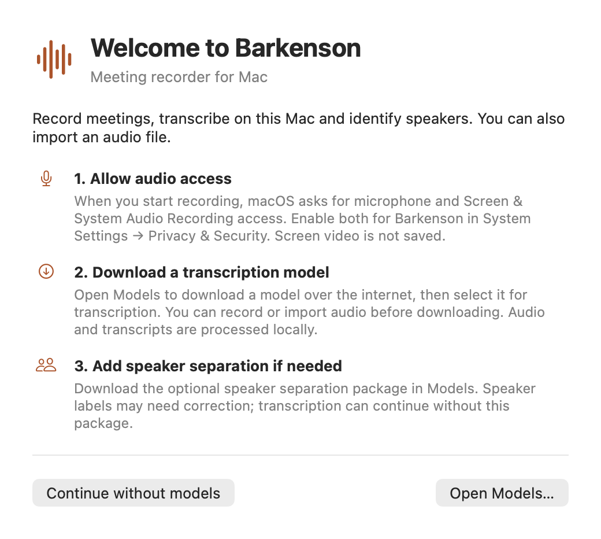
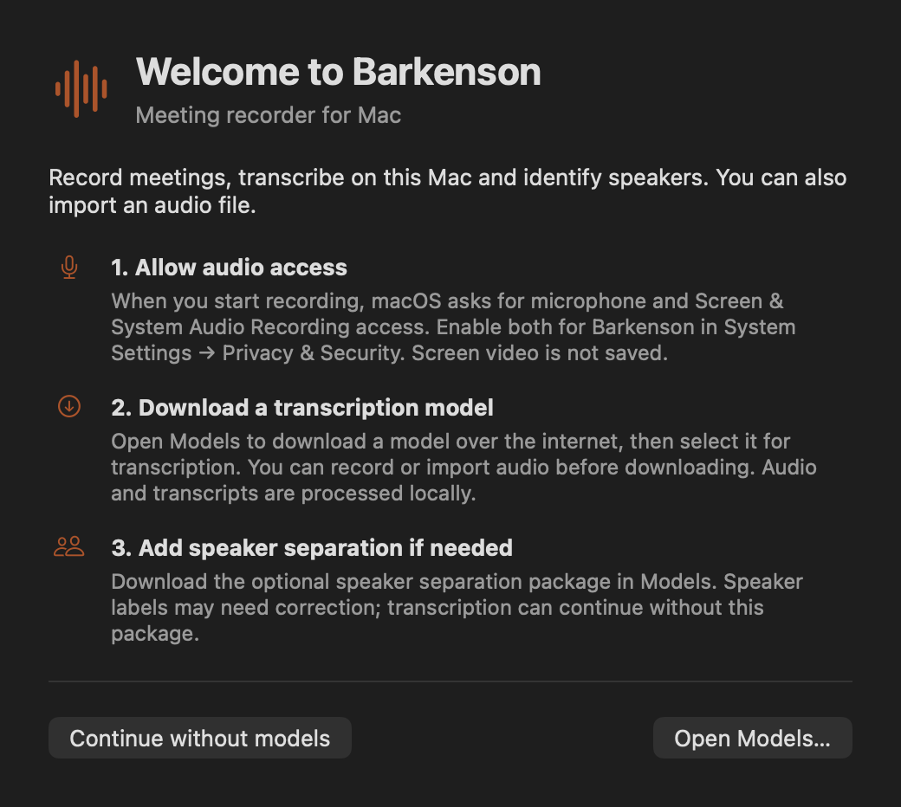
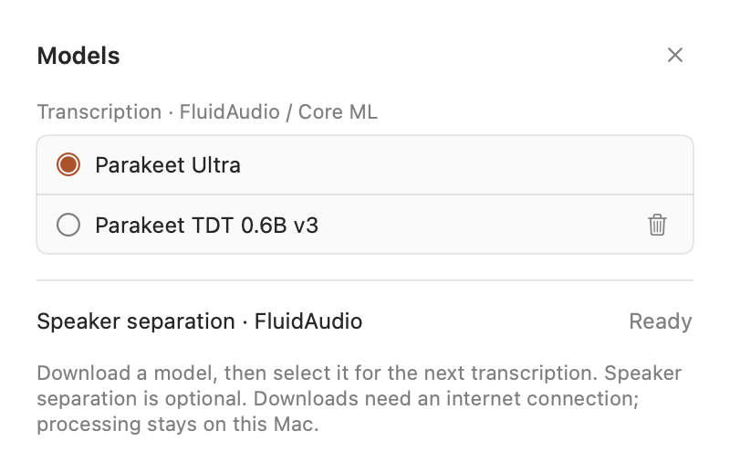
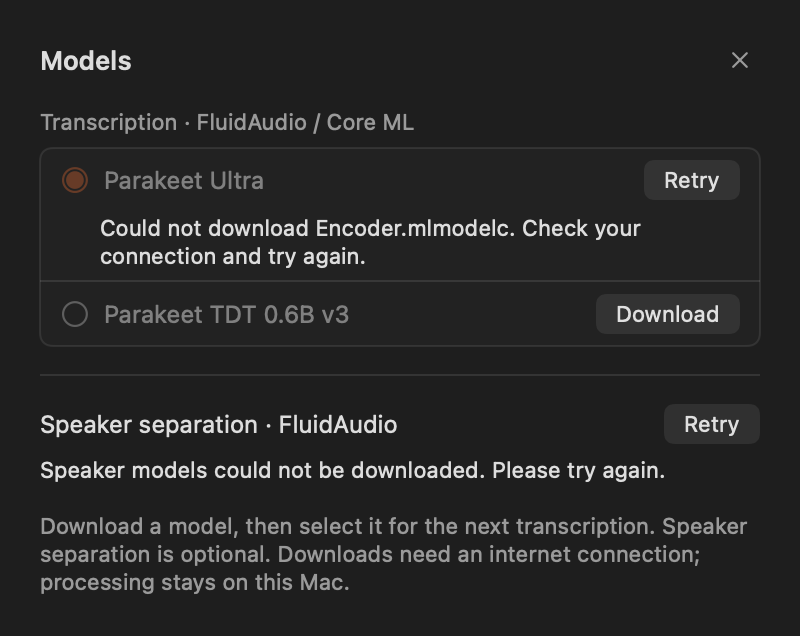

# Barkenson app preparation — verification

20 October 2026. Branch: `codex/barkenson-app`, based on `develop` at `327e976460b363d621a150d4c0d4b085e2cafabe`. Implementation and packaged source: **`3d390943036c622505b702d5ec981274a429a0fa`**. Subsequent report-only commits do not change application source.

## Delivered scope

The owner approved Barkenson, native macOS typography, a warm orange accent and removal of inactive summary UI. Final icon artwork is explicitly deferred. The existing icon remains.

- Public bundle/window/About/menu and privacy explanation names say Barkenson; version **0.1.0 (5)**. Native About and the Models menu shortcut use AppKit/SwiftUI conventions.
- Summary tab, disabled generation controls, copy-summary action and summary search prompt are removed. Transcript selection/copy/export and audio controls remain. Stored summary artefacts and disabled Store/workflow entry points are preserved.
- Welcome explains recording permissions, explicit model download/selection and optional speaker separation. It routes to the existing SDK-backed Models panel, without downloading or selecting anything automatically. A single sheet owns welcome and Models, including app-menu requests. Recovery discovery/prompts and errors take priority over welcome.
- Light-appearance toolbar icons use semantic foreground colours. Native selectable 14-point transcript text, long-text layout and existing playback behaviour remain unchanged. The obsolete placeholder-ASR empty-state message is corrected.
- Packaging stages `Barkenson.app` and a Barkenson-named ZIP while retaining the internal Xcode product/executable. Build/upgrade instructions are in [the dedicated guide](barkenson-build-and-upgrade.md). README, its PR #22 refresh and publication remain coordinator-owned.

No inference implementation, model pin/provider/selection behaviour, audio/persistence contract, existing preference key, bundle identifier, signing identity or canonical storage path was changed. The only new preference is `barkenson.welcomeSeen`. Store publishes a transient recovery-readiness flag solely for presentation ordering; recovery work/policy is unchanged.

## Fresh automated checks

Mac with Xcode **26.3 (17C529)**; native arm64 test destination.

```sh
xcodebuild -project Recordly.xcodeproj -scheme Recordly \
  -configuration Debug -destination 'platform=macOS,arch=arm64' \
  -derivedDataPath build/branding-baseline CODE_SIGNING_ALLOWED=NO test
```

Final result: **397 tests, 8 optional skips, 0 failures**, `TEST SUCCEEDED`, exit 0. Local log: `/private/tmp/barkenson-final.log`; result bundle is under the ignored `build/branding-baseline/Logs/Test/` directory. This includes bundle-name/retained-identifier/executable compatibility, existing path/preferences/session tests, disabled summaries, capture/import/playback/transcription/diarisation/recovery coverage and a new suspended-recovery readiness regression.

Baseline before changes: 395 tests, eight skips, zero failures. The public-name test first failed on Recordly/missing CFBundleDisplayName, then passed after the metadata change. An intermediate full run had one failure because a hosted test attempted to read `model-registry.json` from the Documents source tree. That test now copies the identical shipped bundle fixture, avoiding a developer-folder privacy dependency; final runs pass. The recovery regression initially exposed the missing readiness signal; it now checks that readiness waits while discovery is suspended.

Three existing script guards passed: `test-build-unsigned-app.sh`, `test-build-distribution-app.sh`, `test-local-signing.sh`. The first two confirm disabled entry points remain disabled; they do not certify a distribution build. The signing script test uses its existing mocked boundary. `zsh -n`, plist/project lint and `git diff --check` passed.

Review found and corrected the asynchronous welcome/recovery race. A second review of the readiness and single-sheet changes found no remaining material issues. Review did not independently run hardware/GUI acceptance.

## Native view rendering

The existing opt-in model render test was extended to cover welcome and recording detail in light/dark appearances. The final explicit run passed **one test, zero skips, zero failures**, producing ten PNGs: ready light/dark Models, missing/downloading/preparing/failed Models, welcome light/dark and recording detail light/dark. Images were visually inspected for layout, readable text, semantic colours, action labels and removal of summary UI. White text on the solid accent has a calculated contrast ratio of approximately **5.1:1**; this is not a complete accessibility audit.

Shell/scheme environment attempts initially skipped the opt-in probe. The successful run used a generated, ignored `.xctestrun` with `RecordlyTests.EnvironmentVariables.RECORDLY_MODEL_PICKER_RENDER` set to `/private/tmp/barkenson-ui-review/models.png`:

```sh
xcodebuild build-for-testing -project Recordly.xcodeproj -scheme Recordly \
  -configuration Debug -destination 'platform=macOS,arch=arm64' \
  -derivedDataPath build/branding-baseline CODE_SIGNING_ALLOWED=NO
# Copy the generated Recordly_*.xctestrun within Build/Products and set the above environment value.
xcodebuild test-without-building \
  -xctestrun build/branding-baseline/Build/Products/BarkensonReview.xctestrun \
  -destination 'platform=macOS,arch=arm64' \
  -only-testing:RecordlyTests/ModelSettingsViewModelTests/testRenderModelPickerForReview
```

Final render log: `/private/tmp/barkenson-final-render.log`. These are native view renders using synthetic preview/model states, **not screenshots or interaction acceptance of an installed release**. No private meeting text/audio is included. Selected examples:

| Welcome, light | Welcome, dark |
| --- | --- |
|  |  |

| Models, ready | Models, example error |
| --- | --- |
|  |  |

## Fresh local Release package

```sh
RECORDLY_BUILD_DIR="$PWD/build/branding-release" \
RECORDLY_PACKAGE_CACHE="$PWD/build/branding-baseline/SourcePackages" \
./scripts/build-standalone-local.sh
```

Completed with exit 0 / `BUILD SUCCEEDED` from the implementation commit above. The branch was clean before packaging. The archive is ignored and was not uploaded or committed.

| Evidence | Result |
| --- | --- |
| ZIP | `build/branding-release/Barkenson-3d39094-local.zip`, **24,075,558 bytes** |
| ZIP SHA-256 | `e4e6fcd5a05af7f222baf71a41e35f570a413e578630eb8339f0d67e614526e0` |
| Extracted executable SHA-256 | `3998bd6902ab51cbf497b8c39556cf099f3924756489f429255dfdda53287e46` |
| Public metadata | Name/display name Barkenson; 0.1.0 (5); minimum macOS 15.0; AccentColor |
| Retained metadata | Identifier `com.local.Recordly`; executable `Recordly` |
| Architecture | Universal arm64 + x86_64; this is not an Intel inference-support claim |
| Signature | Extracted app passes `codesign --verify --deep --strict`; authority Recordly Local Development; no TeamIdentifier, no hardened-runtime/notarisation claim |
| Designated requirement | `identifier "com.local.Recordly" and certificate root = H"b5b4e764405e28dd9d5a814d5241c77b5c591e8e"`; identical to the requirement read from `/Applications/Recordly.app` |
| Archive inspection | 128 entries, Barkenson.app root, notices present, no model weights or session/transcript/audio artefacts; the existing `Resources/Models/README.md` is documentation only |
| Extraction/code integrity | Archived/extracted executable bytes match. Built/final executable payloads match after stripping signatures on throwaway copies; adding notices and re-signing legitimately changes embedded signature bytes |

Local extraction: `build/branding-extracted/Barkenson.app`; final package log: `/private/tmp/barkenson-final-package.log`. The extracted application was **not launched or installed**. Existing installed apps, TCC grants, recordings and models were not manually replaced, reset or moved by this task.

## Remaining acceptance

Final icon/designer artwork remains deferred by agreement. Native render and unit checks do not certify live UI interactions, actual privacy consent/denial, an installed-app upgrade/rollback preserving existing records/model selections, real microphone/system capture, long recording/sleep recovery or first launch on another Mac. These require the coordinator/release engineer's controlled acceptance environment. No models were downloaded or real meeting reprocessed for these checks.

Developer ID/notarisation, Gatekeeper on a downloaded/quarantined archive, clean-Mac installation and publication are unverified. The existing local certificate proves local signing only. The checked ZIP is an integration candidate, not a public release. Repository rename, Pages, README integration and release publication remain with the coordinator.
