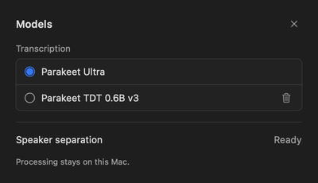

# Minimal Models panel — 2026-10-16

The user rejected the previous catalog as still too large and requested a genuinely small panel in the style of Spokenly and macOS settings. This revision supersedes the earlier 1040×680 layout.

The ready panel is **400×230 points** (native Retina capture: 800×460 pixels). It contains a 13-point Models heading, two compact transcription choices and one speaker-status row. Decorative icons, column headings, runtime/features text, model descriptions, recommendation badges and the disabled-summary card are removed. Model size/runtime information is available in help. Standard small buttons handle download/retry; the small trash glyph and close control have 20×20-point targets, while selection spans the 22-point row. Custom files are collapsed; expanding them reveals a scroll area capped at100points.

Download and selection remain distinct, and uninstalled choices cannot be activated. Existing deletion guards, progress, failures/retry, diarization busy state and stored selection are unchanged. Both stages are visible directly, so a requested diarization focus no longer requires scrolling. Content height grows only for progress, errors or an expanded file list. Inference/audio/storage code is unchanged.

## Checks

- Initial combined model-settings/ASR checks: **43 tests, 0 failures, 1 optional native smoke skipped**.
- Final settings/render checks after hit-area/list-bound refinements: **5 tests, 0 failures**.
- Six intrinsic-size native SwiftUI/AppKit render fixtures inspected: ready dark/light, missing, downloading, preparing and failed. Test preferences/cache markers are isolated from user data. The image above is the native ready capture reduced to1× for display.
- Read-only review found a potential expanded-file overflow; it was fixed with bounded scrolling and re-reviewed with no remaining actionable findings.
- App build incremented to **3**; version remains0.1.0. See the [standalone record](../releases/standalone-2026-10-16-compact-model-panel/README.md) for archive/signature/install evidence.

Design references: [Apple HIG Settings](https://developer.apple.com/design/human-interface-guidelines/settings), [Accessibility](https://developer.apple.com/design/human-interface-guidelines/accessibility), and the user's Spokenly screenshots. This is a focused native-control implementation, not a claim of exhaustive HIG certification.
