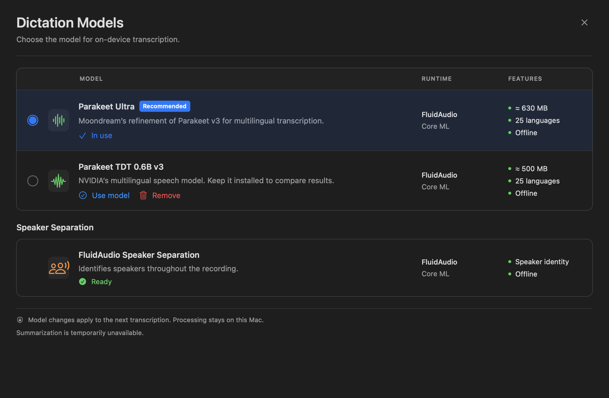

# Models screen redesign — 2026-10-16

The previous Models sheet mixed a large rounded title, repeated section headings and an oversized diarization card. The user requested a complete relayout using their Spokenly reference.

## Delivered presentation

One 24-point heading, a short subtitle and a close/Escape action stay above the scroll area. Ultra/v3 share a compact ruled catalog with radio selection, small icons, descriptions, text actions, runtime and features. The separate speaker section uses the same geometry with a single readiness status. Disabled summaries are a muted footer, rather than another card. Custom local artifacts remain a separately labeled read-only list.

The sheet defaults to 1040×680 and supports 900×620. The ready catalog and footer fit at the compact size; long errors and downloads can scroll, with the heading kept outside that region. System light and dark appearances are supported. Download/Use remain separate; selected-model and workflow deletion guards, per-file SDK progress, retry and speaker-section focus are preserved. Model settings do not load inference weights merely to browse.

The diarization download action previously copied its provider state only after awaiting completion. It now publishes busy immediately and rejects repeated clicks until completion. No ASR, audio/chunk, inference-routing, speaker-matching, recording-data or summary-generation code was changed.

[Compact render](assets/model-picker-redesign-compact-2026-10-16.png)

## Verification

- Model-settings and FluidAudio ASR tests: **43 tests, 0 failures, 1 optional native smoke skipped**. The earlier native Ultra/v3 acceptance remains separate historical evidence; inference was not changed or rebenchmarked for this relayout.
- Suspended diarization-download regression: observed RED with absent busy state, enabled download and duplicate requests, then GREEN after the view-model fix.
- Existing opt-in AppKit/NSHostingView harness renders seven cases: ready 1040×680, ready 900×620, light, missing, downloading with fraction, indeterminate preparation and failed. Fixtures use isolated preferences/cache markers, with no model download or recording mutation. Preview artifacts are native SwiftUI rendering, not a screenshot of a launched Release app.
- Read-only code review found no remaining actionable issues.
- App version remains 0.1.0; build number is **2**, distinguishing this screen from the previous standalone.

See the [standalone delivery record](../releases/standalone-2026-10-16-models-layout/README.md) for source, archive checksums, signing and installation/restart state. The build and final installation evidence is recorded there after packaging.
