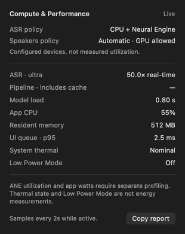

# Compute and performance diagnostics — 2026-10-16

The small chip icon beside Models opens a 310-point diagnostics popover. Blue means a measured stage is active, not proof that the Neural Engine is busy. Models remains the existing 400×230-point panel. The popover separates configured devices from measured process resources and elapsed time.

The screenshot is a native SwiftUI render with **illustrative fixture values**, not benchmark results. Actual measurements are below.

## What the app measures

- Model setup, ASR, diarization execution and whole-job elapsed time, with completed/failed/cancelled outcomes. Model setup is excluded from ASR time. Pipeline time excludes queue wait and includes cache reuse; its ratio is not model speed.
- Recent ASR speed is total input duration / total successful ASR runtime for the last measured model, within the bounded 96-stage history. This is speed relative to audio duration, not speedup versus a GPU.
- Process CPU time divided by elapsed time: 100% means one CPU core, and values may exceed 100%. This is not ANE utilization.
- Resident process memory, main-queue scheduling delay (p95 of the last 30 probes), system thermal state and Low Power Mode. Queue delay is not FPS, complete frame latency or a comprehensive UI benchmark. Thermal/Low Power Mode are not watts.

The sampler uses a serial utility queue every two seconds while recording, processing or viewing diagnostics. It stops when all three are inactive. At most one main-queue probe is pending. Log I/O is off the main thread; only the independently observed diagnostics UI receives sampled updates. Queued transcription work uses utility priority. These changes establish observability and reduce competition with interactive work; they do not prove the app is lag-free.

Local JSONL logs are written to `~/Library/Application Support/Recordly/diagnostics/performance.jsonl`, bounded to 256 KiB plus one previous file. They contain metrics, stage/model names and timestamps, without transcript text, audio, session titles or recording paths. The explicit Copy report button copies the current bounded snapshot. Normal tests disable default log persistence; `RECORDLY_PERFORMANCE_LOG` can opt into a separate path. No upload is performed.

Recordly Stage signposts can be inspected with Instruments. Their emission occurs on the utility queue, so exact elapsed values come from the original monotonic begin/end boundaries in JSON, not delayed signpost emission times.

## Compute policy and device evidence

ASR now explicitly passes `MLModelConfiguration.computeUnits = .cpuAndNeuralEngine`, the SDK's existing default. Core ML may use CPU and ANE but does not use GPU under this policy. Diarization retains its existing `.all` policy: GPU use is allowed. There is no claim that all Recordly work runs on ANE or that the app never uses GPU.

The separate `scripts/inspect-coreml-placement.swift` tool inspected the Ultra encoder on this Mac. Its preferred operation counts were **1,376 ANE, 9 CPU and 2,013 unknown**. Counts are not execution-time shares, live utilization or watts. The same result in a legacy `parakeet-tdt-0.6b-v3-coreml` folder is recorded as legacy inspection only; it is not evidence that canonical managed v3 is installed or active. The valid managed v3 folder was absent during this run. No model was downloaded, restored or silently substituted.

[Raw Core ML placement report](measurements/2026-10-16-coreml-placement.json).

## Bounded native Ultra measurement

Apple M3 Pro (`Mac15,6`), 18 GiB memory, 11 CPU cores, macOS 26.7.1 (25G241). FluidAudio 0.17.7, revision `503b4bd1bbf7220882de39fe8ae6716aae4132da`. Read-only first 30 seconds from one saved audio chunk; raw ASR backend, not a full meeting or full diarization pipeline. Timed-text alignment checks passed. Model load and ASR started off the main thread.

An initial cold model preparation took **15.017 s**. Subsequent ASR spans were 0.689 / 0.388 / 0.392 s for the same 30-second clip. A later fresh test process reused OS/Core ML preparation caches:

| Measurement | Later run |
|---|---:|
| Model preparation | 0.755 s |
| ASR-only spans, three passes | 0.433 / 0.382 / 0.382 s |
| Engine API wall time, including mapping/validation | 1.249 / 0.425 / 0.390 s |
| Repeated engine API speed relative to audio | about 71–77× real-time |
| Available resource probes | 2 |
| Main-queue delay in those probes | 44.9 / 21.0 ms |
| CPU delta, one available interval | 132.9%, about 1.33 CPU cores |
| Last sampled resident memory | 313 MiB |
| System thermal / Low Power Mode | Nominal / Off |

[Raw later-run metrics](measurements/2026-10-16-ultra-performance.json). Dates in this fixture JSON use Foundation's default seconds since 2001; app JSONL and copied reports use ISO 8601.

The two UI probes are too few to establish a meaningful latency distribution. Sampled RSS is not peak memory. Debug test-host timings and a short warmed clip do not establish release performance, meeting-wide accuracy, energy savings or a 10–20× speedup versus GPU models. Managed v3 was unavailable, so this run makes no current Ultra/v3 comparison. Earlier functional v3 acceptance remains historical evidence.

## Verification and profiling next steps

Full application suite: **392 tests, zero failures, eight optional skips**. Final diagnostics/native/render/lifecycle checks after signpost/UI polish: **8 tests, zero failures, zero skips**. Tests cover weighted metrics, cancelled/failed handling, bounded history, CPU baseline resets, duplicate span endings, interest leases, stopping an idle timer and rejecting late probes. Read-only code review found no remaining actionable issues. The screenshot validates native layout; installed GUI clicks are not automated evidence.

Next, profile the installed release during a representative complete recording and transcription. Use Instruments Core ML/Power Profiler/Time Profiler attached specifically to Recordly (not all processes), correlate Recordly Stage signposts, and compare idle, capture and processing under the same power/thermal conditions. No power trace was collected in this delivery. This is needed before asserting actual ANE utilization, per-app energy use or battery improvement.

Apple references: [CPU + Neural Engine policy](https://developer.apple.com/documentation/coreml/mlcomputeunits/cpuandneuralengine), [Core ML performance analysis](https://developer.apple.com/documentation/coreml/analyzing-a-core-ml-model-s-performance-in-xcode), [ProcessInfo](https://developer.apple.com/documentation/foundation/processinfo).
