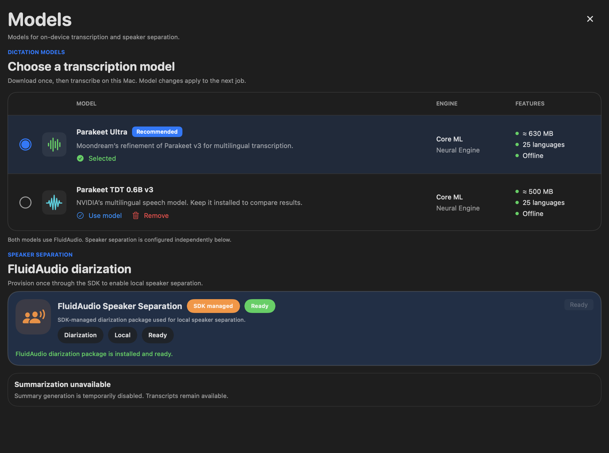

# Parakeet Ultra and model picker — 2026-10-16

Recordly now defaults to **Parakeet Ultra** and retains **Parakeet TDT 0.6B v3** as an explicit alternative. Both use the pinned FluidAudio 0.17.7 Swift SDK and its Core ML CPU/Neural Engine configuration. SDK version/revision, bounded Audio Pipeline V2, AAC capture, diarization models/voice identity matching and disabled summaries are unchanged. This builds on the separate transcript-spacing correction, commit `4783b3d`.

## Model selection

Models uses the supplied Spokenly table as a visual reference: radio selection, highlighted active row, model descriptions and link actions. Only integrated engines are listed. No numerical quality or speed ratings are invented. Model sizes are approximate package sizes, not a live disk reading. Speaker separation remains a separate section.

- Ultra is the fresh default, including installations with only v3 cached. An unavailable selected model blocks transcription with a download prompt; there is no silent v3 fallback.
- Download and Use are separate actions. Selection is stored in `fluidAudio.asr.selectedModel`; an in-flight job retains its original URL across all its windows.
- Per-model readiness requires the canonical SDK cache path, complete compiled markers, vocabulary and no staged `.partial` files. Download uses the supplied cache root. Retry repairs invalid compiled components while keeping complete siblings.
- The SDK reports progress for each asset individually. UI labels it as current-asset progress, without presenting a misleading whole-package percentage. Failed download has an error and retry action.
- Selected-model deletion is rejected. The workflow owner also rejects UI deletion while any job is queued/running, protecting an earlier model frozen into an active profile after selection changes.
- The backend loads the matching `.ultra`/`.v3` SDK version and caches one manager. Distinct ASR model fingerprints prevent v3 cache reuse as Ultra. Existing v3 fingerprints remain compatible; speaker model fingerprints/names are independent.

## Verification

- Two initial regressions failed on the previous implementation: default provider resolved v3 and Ultra was fingerprinted as v3.
- Combined suite with the spacing fix: **383 tests, 0 failures, 5 optional skips**. The SwiftUI render check was enabled; native acceptance cases require explicit local paths.
- Final button styling: **4 model-settings tests, 0 failures**, including actual `NSHostingView` rendering. Screenshot below uses isolated synthetic installed-model fixtures; it is not a click-through test of Applications. Native UI automation permission was unavailable.
- Installed-model acceptance: **2 tests, 0 failures** (model render and native Ultra/v3). Both models transcribed the same temporary 30-second excerpt and returned decoded text plus timed tokens. Ultra: **14.22 s**, v3: **17.49 s**, including model setup. A single cold run does not establish accuracy, steady-state speed or energy savings. Private audio/text remain outside Git; the source recording was not changed by this acceptance test.
- A further native repeat passed after adding assertions that both models’ timed tokens reconstruct the decoded text exactly through `ASRTimedText`, covering compatibility with the spacing correction.
- Read-only code review found the incomplete-cache retry issue; repair and regression were reviewed after correction. `git diff --check` passed.

## Limits

No annotated multilingual accuracy or whole-app energy benchmark was run. Core ML/ANE placement is retained, but this is not a promise that every operation runs on ANE. Existing speaker-matching limits remain: short/overlapping/noisy turns can remain local or unknown. Switching ASR does not prove meeting-wide speaker continuity. Historical transcripts change only when explicitly reprocessed.
